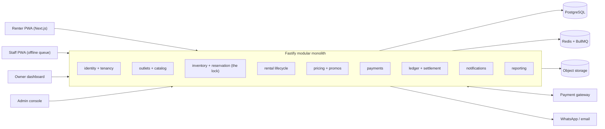

# Tech Stack and Architecture: Jambi Bike Rental Platform

Version 1.0 | 3 November 2026 | Companion to the PRD "Jambi Bike Rental Network: PRD and System Architecture"

## 1. Approach

You are a JavaScript web developer, so this plan uses **TypeScript end to end** and a **modular monolith**. The PRD lists nine services (identity, catalog, inventory, rental, pricing, payments, ledger, notifications, reporting). Treat them as **modules inside one Node.js app**, not as separate deployments. Four outlets and 150 bikes do not justify microservices, and one deployable is far easier to run alone.

The three PRD rules shape every choice below:

1. **Station-to-station:** every bike row always points to a physical outlet and a custody state.
2. **Booking-to-inventory lock:** the database, not the client and not the 5-minute sync, decides whether a bike is available.
3. **No dockless:** there is no bike GPS table, no bike map endpoint and no "end ride from phone" action. A rental ends only through a staff scan-in.

Two PRD items are still on hold (down-payment, ID verification method). The design leaves a clean seam for both so the meetings do not block the build (see section 9).

## 2. Stack at a Glance

| Layer | Choice | Why it fits you |
|---|---|---|
| Language | TypeScript (strict mode) | One language everywhere; share types and Zod schemas between API and clients |
| Repo | pnpm workspaces + Turborepo | One repo, shared packages, one CI pipeline |
| API | Node.js + Fastify + Zod | Close to Express, faster, schema validation built in |
| Database | PostgreSQL | Row-level locks, time-range types and row-level security solve the lock and multi-tenancy problems natively |
| Queries | Drizzle ORM, raw SQL for the lock | SQL-shaped TypeScript; you can see exactly what runs |
| Jobs | Redis + BullMQ | Hold expiry, no-show release, weekly settlement, notifications |
| Web apps | Next.js (React), Tailwind, shadcn/ui, TanStack Query | Renter site, owner dashboard and admin console in one app |
| Staff app | Vite + React installable PWA, Dexie (IndexedDB), Workbox | Offline scan queue without learning a native toolchain |
| Realtime | Server-Sent Events | One-way availability and dashboard updates; simpler than WebSockets |
| Auth | Better Auth or Auth.js (check maintenance status at build time) | Roles, sessions, OTP flows without hand-rolling crypto |
| Payments | Xendit or Midtrans | Public sources list GoPay, OVO, cards and QRIS for both; confirm in sandbox before committing |
| Files | S3-compatible object storage | Condition photos and ID images |
| Messaging | WhatsApp Business API through a provider, plus email | WhatsApp is the main channel in Indonesia |
| Observability | Sentry, pino logs, uptime monitor | Cheap and enough for launch |
| Testing | Vitest, Playwright, a concurrency test script | The lock needs real parallel tests |
| Hosting | Managed container platform, managed Postgres and Redis, nearest region (Singapore, or Jakarta if offered) | No Kubernetes, no server patching |

**Why a PWA first:** the PRD says "mobile app", and an installable PWA delivers that with the React skills you already have. If you later need app store presence, wrap the same web code with Capacitor rather than rewriting in React Native.

**Payment gateway note:** the weekly Tuesday payouts need a payout (disbursement) API as well as payment collection. Check this in each gateway's sandbox first, because it may decide the choice.

## 3. System Diagram



## 4. Repository Layout

```
bike-rental/
├─ apps/
│  ├─ api/            Fastify app: modules/, jobs/, plugins/
│  ├─ web/            Next.js: (renter)/, (owner)/, (admin)/ route groups
│  └─ staff/          Vite + React PWA for outlet counters
├─ packages/
│  ├─ db/             Drizzle schema, migrations, SQL helpers
│  ├─ contracts/      Zod schemas and shared TypeScript types
│  └─ config/         tsconfig, eslint, tailwind presets
└─ turbo.json
```

Inside `apps/api/src/modules/`, each PRD service gets a folder (`inventory/`, `ledger/`, and so on). **One rule keeps the monolith clean:** a module may call another module only through its exported functions, never by importing its tables.

## 5. Data Model and the Inventory Lock

### 5.1 Core tables

| Table | Key columns |
|---|---|
| `owners` | id, name, bank account (for payouts) |
| `outlets` | id, owner_id, code (JMB-001), name, lat, lng, hours |
| `sister_groups` | id, owner_id, outlet ids (owner-scoped; unused until an owner opens a second outlet) |
| `bikes` | id, asset_tag, category, home_outlet_id, current_outlet_id, state |
| `bike_events` | id, bike_id, type, outlet_id, staff_id, rental_id, photo_urls, created_at (append-only custody trail) |
| `reservations` | id, renter_id, outlet_id, category, starts_at, ends_at, status, expires_at |
| `rentals` | id, reservation_id, bike_id, checked_out_at, checked_in_at, checkin_outlet_id |
| `renters` | id, phone, verification_status, deposit_status |
| `ledger_entries` | append-only money movements (section 7) |

`category` is a Postgres enum or lookup table seeded with commuter, road, mtb and fixie. Adding `ebike` later is a data change; battery and charge-state attributes go in a nullable `attributes` JSONB column.

**Bike states:** available, held, reserved, in_rental, pending_inspection, maintenance, unavailable (and `charging` reserved for e-bikes). Only the rental module changes them, and every change writes a `bike_events` row.

### 5.2 The reservation transaction

Availability is computed, not stored as a counter that can drift. Competing bookings for the same outlet and category are serialized with a row lock on a small `outlet_categories` table (one row per outlet and category).

```ts
// apps/api/src/modules/inventory/reserve.ts  (sketch, not production code)
export async function reserve(input: ReserveInput) {
  return db.transaction(async (tx) => {
    // 1. Serialize bookings competing for this outlet + category.
    await tx.execute(sql`
      SELECT 1 FROM outlet_categories
      WHERE outlet_id = ${input.outletId} AND category = ${input.category}
      FOR UPDATE`);

    // 2. Capacity = in-service bikes homed at this outlet
    //    minus overlapping holds, reservations and open rentals.
    //    An open rental counts as running until its staff scan-in,
    //    so a late bike never gets double-booked.
    const { inService, committed } = await countCapacity(tx, input);

    if (committed >= inService) throw new SoldOutError();

    // 3. Insert the hold with an expiry; a BullMQ job releases it if unpaid.
    return insertReservation(tx, { ...input, status: "held" });
  });
}
```

Why this works: two renters tapping "book" at the same moment queue behind the row lock, so the second one sees the first one's hold and gets `SoldOutError`. The 5-minute outlet sync never touches this path.

### 5.3 Timers without trusting Redis

Every hold stores `expires_at` in Postgres. BullMQ jobs release holds and no-shows at that time, and a **sweeper job every minute** releases anything the queue missed. Redis can lose a job without losing a booking.

Timers from the PRD: unpaid checkout holds lapse after 15 minutes; a paid reservation is released as a no-show 1 hour after its scheduled start.

## 6. Multi-Tenancy and Owner Isolation

Owners must never see each other's fleets or money. Use two layers:

1. **Application layer:** every owner-scoped query goes through a repository helper that requires `ownerId`.
2. **Database layer:** Postgres row-level security as the safety net.

```sql
ALTER TABLE ledger_entries ENABLE ROW LEVEL SECURITY;

CREATE POLICY owner_isolation ON ledger_entries
  USING (owner_id = current_setting('app.owner_id')::uuid);
```

```ts
// Per request, inside the transaction:
await tx.execute(sql`SELECT set_config('app.owner_id', ${ownerId}, true)`);
```

Admin and system jobs use a separate database role that bypasses these policies. Test isolation explicitly: log in as owner A and try to read owner B's outlet, bikes and ledger.

## 7. Ledger and Settlement

Money is stored as **integer rupiah** (never floats) and every movement is an **append-only ledger entry**.

| Entry type | Created when |
|---|---|
| `rental_revenue` | A rental completes |
| `platform_commission` | Same moment; 18% (1800 basis points) |
| `promo_share` | A promotion applied; cost split 50/50 unless the owner opted out |
| `late_fee_share` | Late penalty split 50/50 |
| `refund_reversal` | Mechanical-failure refund; renter refunded in full, owner ledger reversed, platform commission not reversed |
| `payout` | Tuesday transfer to the owner bank account |

A `commission_rules` table (owner_id nullable, rate_bps, base = `pre_discount` or `post_discount`, effective_from) holds the commission. The PRD says commission is pre-discount now and may switch to post-discount later, so switching is **one new row, not a deploy**.

**Schedule (all in the `Asia/Jakarta` timezone, WIB):**

```ts
// Weekly cut-off ends Sunday 23:59; statements built Monday just after midnight.
await settlementQueue.add("build-statements", {}, {
  repeat: { pattern: "5 0 * * 1", tz: "Asia/Jakarta" },
});
// Payouts run Tuesday; balances under IDR 100,000 roll over.
await settlementQueue.add("run-payouts", {}, {
  repeat: { pattern: "0 9 * * 2", tz: "Asia/Jakarta" },
});
```

Store timestamps in UTC and compute week boundaries in WIB. Make both jobs **idempotent** (keyed by owner and week) so a retry never pays twice. Weekly statements are generated as PDFs and shown in the owner dashboard with line-level drill-down.

## 8. Staff App and Offline Behavior

Outlet connectivity may be unreliable, but the staff app must keep working.

- Scans (check-out, check-in, inspection) are saved to IndexedDB with a **client-generated UUID** and timestamp, then sent when online.
- The API treats the UUID as an **idempotency key**, so a replayed scan is harmless.
- Scans are facts about the physical world, so the server accepts them and only flags impossible ones (for example, a bike scanned out that is already in a rental) for admin review.
- The server stays the authority for availability. While a counter is offline, renters still see the server's view, which is the safe direction.
- QR vouchers and bike tags use **signed, rotating tokens** so screenshots and photocopied tags are useless.

## 9. Security and the Two On-Hold Decisions

- **ID documents** are the most sensitive data. Store images in a private bucket, encrypt at rest, restrict access to a small role, log every view, and define a retention period. Indonesia's personal data protection law applies, so have the obligations reviewed by someone qualified before launch.
- **ID verification method (on hold):** wrap it behind a `VerificationProvider` interface (`submit()`, `getStatus()`). Start with a manual-review implementation if needed and swap in an automated provider later with no change to the booking flow.
- **Down-payment (on hold):** the payments module uses a generic `payment_intents` table (purpose, amount, status). Today a booking has one intent. If you adopt a down-payment, you add a second intent type and the no-show penalty rule. No schema redesign.
- **Deposit:** a `deposit_status` on the renter and a `deposits` table are included. Amount and release rules are still to be decided.
- **Webhooks:** verify gateway signatures, store the raw event, and process idempotently by event id.
- **Audit log:** custody, ledger and settlement changes are append-only.

## 10. What Will Be Familiar and What Will Be New

| Familiar | New, so learn early |
|---|---|
| TypeScript, React, Node, REST APIs | Postgres transactions and `SELECT ... FOR UPDATE` |
| Tailwind, component libraries, forms | Row-level security |
| Authentication and sessions | Queues, retries and idempotent jobs |
| Deploying a web app | Offline-first PWAs (service workers, IndexedDB) |
| Dashboards and charts | Append-only ledgers and money handling |

Spend your first learning time on the lock. Build `reserve()` and a test that fires 50 parallel requests at an outlet with 5 bikes, and assert exactly 5 succeed. That test protects the PRD's most important rule.

## 11. Build Order (matches the PRD phases)

**Phase 1: launch**
1. Database schema, seed the 4 outlets and 150 bikes from the network specs, and the reservation lock with its concurrency test.
2. Staff PWA: scan check-out and check-in, condition photos, offline queue.
3. Renter site: outlet browsing, availability by category, booking, payment, QR voucher.
4. Hold expiry and no-show jobs, with the sweeper.
5. Basic owner dashboard (live rentals, bike status, earnings accrual).

**Phase 2: money and reporting**
6. Ledger, commission rules, promotions engine.
7. Weekly statements, Tuesday payouts, dispute queue.
8. Utilization and performance reports.

**Phase 3: growth**
9. Sister-outlet groups in production, e-bike category, optional Capacitor wrapper.

## 12. Risks and Mitigations

| Risk | Mitigation |
|---|---|
| Overbooking from a race condition | Row-lock transaction plus the parallel-booking test in CI |
| Redis loses a timer | `expires_at` in Postgres plus a one-minute sweeper |
| Double payout on a retry | Idempotency key per owner and week |
| Staff forget to scan a return | Rental stays open, late fees accrue, owner is alerted |
| Gateway lacks a payout API | Confirm in sandbox before choosing; fall back to manual bank transfer files for Phase 1 |
| Over-building early | Stay a monolith; add services only when a real bottleneck appears |
